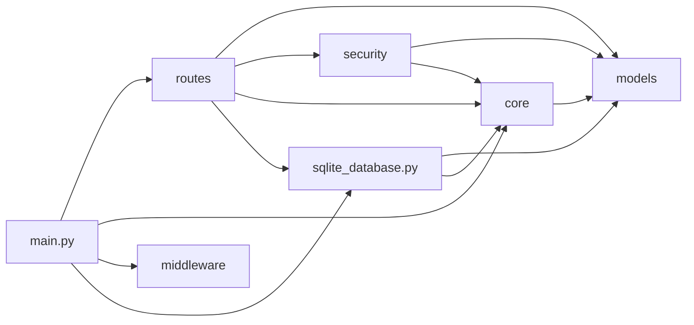

# Customer Support Intent API — Projeto de Bloco (TP1 + TP2 + TP3)

[](https://github.com/johnscottini/jonathan_pedro_vitor_daniel_tp3/actions/workflows/tests.yml)

## Objetivo do projeto

Sistema de atendimento ao cliente apoiado por inteligência artificial. O
repositório reúne a análise dos dados que vão alimentar o classificador de
intenção e a API que vai servi-lo.

**TP1 — domínio, EDA e API base**
1. Documentação e **análise exploratória** do
   [Customer Support Ticket Dataset](https://www.kaggle.com/datasets/suraj520/customer-support-ticket-dataset/data)
   (Kaggle): inspeção inicial, qualidade dos dados, limpeza, análise univariada
   e hipóteses sobre a intenção dos usuários.
2. **API FastAPI** modular com autenticação JWT (`OAuth2PasswordBearer`).
3. **DFD** da API com entradas, saídas, trust boundaries e a tríade CIA.

**TP2 — análise estatística e controles OWASP**
4. **Análise bivariada e testes de hipótese** (correlação, Mann-Whitney,
   qui-quadrado), consolidados em [`docs/relatorio_eda.md`](docs/relatorio_eda.md).
5. **Controles do OWASP Top 10** na API: ownership (BOLA), `extra="forbid"`,
   SQLModel com queries parametrizadas, headers de segurança, CORS com
   allowlist e rate limiting no login.
6. **Auditoria com OWASP ZAP** ([`zap/tp2/`](zap/tp2/)).

**TP3 — modelagem, testes, CI e auditoria final**
7. **Regressão linear** com R², RMSE, Residual Plot e Q-Q Plot (seção 8 do notebook).
8. **Formalização do problema de classificação** de intenção, com a
   distribuição das classes (seção 9 do notebook).
9. **Suíte de testes de segurança** com pytest e `TestClient`
   ([`tests/test_seguranca_tp3.py`](tests/test_seguranca_tp3.py)).
10. **Integração contínua** com GitHub Actions ([`.github/workflows/tests.yml`](.github/workflows/tests.yml)).
11. **Auditoria final com OWASP ZAP**, com correção dos findings Medium
    ([`zap/scan_passivo_zap_TP3.md`](zap/scan_passivo_zap_TP3.md)), e
    documentação interativa completa em `/docs`.
12. **Planejamento** do classificador e do teste adversarial ([`others/planejamento.md`](others/planejamento.md)).

## Estrutura de pastas

```
.
├── README.md                    # este arquivo
├── pytest.ini                   # configuração dos testes (rodar `pytest tests/ -v` da raiz)
├── requirements-eda.txt         # dependências do notebook
├── .github/workflows/
│   └── tests.yml                # CI: roda a suíte a cada push
├── data/
│   └── customer_support_tickets.csv   # dataset bruto (Kaggle)
├── docs/
│   └── relatorio_eda.md         # relatório da EDA (TP2) + regressão e formalização (TP3)
├── eda/
│   └── eda_tp3.ipynb            # notebook único com a EDA completa (TP1, TP2 e TP3)
├── fastapi/                     # código-fonte da API
│   ├── main.py                  # ponto de entrada: monta a aplicação FastAPI
│   ├── database.db              # banco SQLite com usuários e tickets de exemplo
│   ├── sqlite_database.py       # engine, sessão, criação das tabelas e usuários iniciais
│   ├── sqlite_populate.py       # popula o banco com tickets de exemplo
│   ├── requirements.txt         # dependências da API
│   ├── requirements-dev.txt     # + ferramentas de teste
│   ├── core/                    # configuração, handlers de erro e rate limiting
│   ├── routes/                  # endpoints: health, auth, predict, tickets, docs
│   ├── models/                  # schemas Pydantic e tabelas SQLModel
│   ├── middleware/              # headers de segurança HTTP e CORS
│   └── security/                # usuários (bcrypt) e JWT
├── tests/                       # testes automatizados (pytest + TestClient)
├── zap/
│   ├── scan_passivo_zap_TP3.md  # análise dos findings Medium/High do TP3
│   ├── zap_report_tp3.*         # relatório final do scan da API
│   ├── zap_baseline_docs_tp3*.* # relatórios do scan do /docs (inicial e final)
│   └── tp2/                     # auditoria do TP2 (histórico)
└── others/
    ├── planejamento.md          # planejamento TP3: modelo, CountVectorizer, alvo do pentest
    ├── CONTRATO_TP2.md          # divisão de tarefas e decisões do TP2
    ├── dfd.py                   # script que gera o DFD
    └── dfd.png                  # DFD da API com trust boundaries e tríade CIA
```

## Arquitetura da API

### Responsabilidade de cada módulo

| Módulo | Responsabilidade | O que **não** faz |
|---|---|---|
| `main.py` | Monta a aplicação: registra middlewares, handlers de erro e routers. É o único que conhece todos os outros módulos. | Não contém regra de negócio nem validação. |
| `routes/` | Camada HTTP: recebe a requisição, declara o schema de entrada e saída, chama as dependências de segurança e devolve a resposta. | Não define schemas (isso é `models/`) nem valida token na mão (isso é `security/`). |
| `models/` | Contrato de dados: schemas Pydantic de entrada/saída, respostas de erro e as tabelas SQLModel. É o módulo mais interno — não importa nenhum outro. | Não acessa banco, não lê requisição, não conhece rotas. |
| `security/` | Autenticação: hash e conferência de senha (`users.py`), emissão e validação do JWT e a dependência `OAuth2PasswordBearer` (`jwt.py`). | Não define rotas; expõe dependências que as rotas consomem. |
| `core/` | Infraestrutura transversal: configuração por variável de ambiente, handlers de erro e rate limiting. | Não conhece rotas específicas. |
| `middleware/` | Headers de segurança HTTP e CORS, aplicados a toda resposta. | Não autentica nem autoriza. |
| `sqlite_database.py` | Engine do SQLModel, criação das tabelas, usuários iniciais e a dependência `get_session` (uma sessão por requisição). | Não contém queries de negócio — essas ficam nas rotas. |
| `sqlite_populate.py` | Script que insere tickets de exemplo de usuários diferentes. | Não é importado pela API. |

### Dependências entre os módulos

O sentido das setas é "importa". Não há ciclos: a dependência sempre aponta da
camada mais externa (HTTP) para a mais interna (contrato de dados).



### Padrão das respostas

Toda rota declara `response_model`, e toda resposta de erro — 401, 404, 422,
429, 500 — sai no mesmo formato `ErrorResponse`, produzido pelos handlers em
`core/exception_handlers.py`:

```json
{
  "code": "unauthorized",
  "message": "Não foi possível validar as credenciais",
  "path": "/predict"
}
```

`code` é um identificador estável (é por ele que o cliente deve ramificar, não
pela mensagem), e `fields` só aparece em erros de validação (422), listando
cada campo rejeitado.

## Dataset

- **Fonte:** [Customer Support Ticket Dataset](https://www.kaggle.com/datasets/suraj520/customer-support-ticket-dataset/data) (Kaggle, autor `suraj520`, licença CC0).
- **Características, motivo da escolha e EDA completa:** ver [`eda/eda_tp3.ipynb`](eda/eda_tp3.ipynb).
- O CSV usado está versionado em [`data/customer_support_tickets.csv`](data/customer_support_tickets.csv).

## Instalação

Pré-requisito: Python 3.11+ (o CI usa 3.12).

```bash
# na raiz do repositório
python -m venv .venv

# Linux / macOS
source .venv/bin/activate
# Windows (PowerShell)
.venv\Scripts\Activate.ps1

# dependências da API + ferramentas de teste
pip install -r fastapi/requirements-dev.txt

# dependências do notebook de EDA (opcional)
pip install -r requirements-eda.txt
```

As configurações têm defaults seguros para desenvolvimento. Para ajustá-las,
copie `.env.example` para `.env` (variáveis `SECRET_KEY`, `DATABASE_URL`,
`CORS_ORIGINS`, `RATE_LIMIT_LOGIN`...).

## Banco de dados

O banco SQLite já vem pronto em [`fastapi/database.db`](fastapi/database.db), com
três usuários e oito tickets de exemplo distribuídos entre eles. Para recriá-lo
do zero, a partir da raiz do repositório:

```bash
rm fastapi/database.db              # opcional: apaga o banco atual
python fastapi/sqlite_database.py   # cria as tabelas e os usuários iniciais
python fastapi/sqlite_populate.py   # insere os tickets de exemplo
```

Os dois scripts são idempotentes: rodar de novo não duplica usuários nem tickets.
Todas as consultas usam o SQLModel (SQL parametrizado), nunca SQL em string.

| usuário | senha | tickets de exemplo | para quê |
|---|---|---|---|
| `alice` | `alice123` | IDs 1, 2, 3 | usuária comum — demonstra ownership |
| `bob` | `bob123` | IDs 4, 5, 6 | segundo usuário — demonstra o bloqueio de acesso cruzado (BOLA) |
| `admin` | `admin123` | IDs 7, 8 | usuário herdado do TP1 |

São credenciais de **desenvolvimento**, documentadas de propósito para os testes.

## Execução da API

```bash
cd fastapi
uvicorn main:app --reload --no-server-header
```

`--no-server-header` evita que o uvicorn anuncie a própria stack no header
`Server`.

A API sobe em `http://127.0.0.1:8000`. A **documentação interativa** fica em
`http://127.0.0.1:8000/docs`. Cada rota tem descrição, corpo esperado, respostas
possíveis e o cadeado nas rotas que exigem token. Para testar uma rota protegida,
clique em **Authorize**, informe usuário e senha e use *Try it out*.

| Método | Rota | Autenticação | Sucesso | Erros documentados |
|---|---|---|---|---|
| GET | `/health` | — | 200 | — |
| POST | `/auth/token` | — (formulário) | 200 `Token` | 401, 422, 429 |
| POST | `/predict` | Bearer | 200 `PredictResponse` | 401, 422 |
| POST | `/tickets` | Bearer | 201 `TicketRead` | 401, 422 |
| GET | `/tickets` | Bearer | 200 `List[TicketRead]` | 401 |
| GET | `/tickets/{id}` | Bearer | 200 `TicketRead` | 401, 404, 422 |

Fluxo de teste manual com `curl`:

```bash
# 1. Login -> obtém o token JWT
curl -X POST http://127.0.0.1:8000/auth/token -d "username=alice&password=alice123"

# 2. Lista os tickets da alice (IDs 1, 2 e 3)
curl http://127.0.0.1:8000/tickets -H "Authorization: Bearer <TOKEN>"

# 3. Tenta ler um ticket do bob -> 404 (BOLA bloqueado)
curl http://127.0.0.1:8000/tickets/4 -H "Authorization: Bearer <TOKEN>"

# 4. Rota de predição
curl -X POST http://127.0.0.1:8000/predict \
  -H "Authorization: Bearer <TOKEN>" -H "Content-Type: application/json" \
  -d '{"text": "I need a refund for my order"}'
```

`POST /predict` ainda devolve uma intenção **simulada** por palavras-chave. O
classificador planejado em [`others/planejamento.md`](others/planejamento.md)
substitui essa lógica mantendo o mesmo contrato.

## Notebook de EDA

```bash
cd eda
jupyter notebook eda_tp3.ipynb
```

| Seções | TP | Conteúdo |
|---|---|---|
| 1 a 6 | TP1 | Compreensão, inspeção, qualidade, limpeza, análise univariada e hipóteses |
| 7 | TP2 | Heatmap, scatter plots, Mann-Whitney (H2) e qui-quadrado (H1, H3, H4) |
| 8 | TP3 | Regressão linear: alvo `n_palavras_descricao`, R²/RMSE, Residual e Q-Q Plot |
| 9 | TP3 | Formalização: X = texto, y = `Ticket Type`, distribuição das 5 classes |

O resumo dos resultados está em [`docs/relatorio_eda.md`](docs/relatorio_eda.md)
(seções 7 e 8 para o TP3).

## Testes

```bash
pytest tests/ -v
```

47 testes, executados contra um SQLite em memória (o `database.db` nunca é tocado):

| Arquivo | O que cobre |
|---|---|
| [`test_seguranca_tp3.py`](tests/test_seguranca_tp3.py) | **Suíte do TP3**, um bloco por aspecto: autenticação (login válido, senha errada, usuário inexistente), BOLA (leitura e listagem), validação de entrada (campo extra, tipo inválido, tamanho máximo), rate limiting (429) e rotas protegidas (sem token, token inválido) |
| [`test_seguranca.py`](tests/test_seguranca.py) | Os 3 casos do TP2: sem token (401), recurso de outro usuário (404), campo extra (422) |
| [`test_auth_jwt.py`](tests/test_auth_jwt.py) | Assinatura adulterada, token expirado, token sem `exp` e `sub` de usuário inexistente |
| [`test_rate_limit.py`](tests/test_rate_limit.py) | 429 após o limite, com `Retry-After`; demais rotas não são afetadas |
| [`test_headers.py`](tests/test_headers.py) | Headers de segurança, CSP, CORS e as correções do ZAP no `/docs` |
| [`test_docs_openapi.py`](tests/test_docs_openapi.py) | Documentação: `/docs` disponível; rotas com descrição, corpo, respostas e esquema de autenticação |
| [`test_contrato_erros.py`](tests/test_contrato_erros.py) | Formato padronizado de erro em 401, 404 e 422 |
| [`test_smoke.py`](tests/test_smoke.py) | A aplicação sobe e o `/health` responde |

### Integração contínua

O workflow [`.github/workflows/tests.yml`](.github/workflows/tests.yml) roda a cada
push e pull request:

1. obtém o código (`actions/checkout`);
2. configura o Python 3.12 (`actions/setup-python`);
3. instala `fastapi/requirements-dev.txt`;
4. executa `pytest tests/ -v`.

Se qualquer teste falhar, o pytest sai com código diferente de zero e o workflow
termina com erro. Os resultados ficam na aba
[Actions](https://github.com/johnscottini/jonathan_pedro_vitor_daniel_tp3/actions).

## Segurança — controles do OWASP Top 10

| Risco OWASP | Controle implementado | Onde |
|---|---|---|
| **A01 — Broken Access Control (BOLA)** | `GET /tickets/{id}` compara o dono do recurso com o usuário do token e devolve **404** (não 403) para ticket alheio. `GET /tickets` filtra pelo dono. `owner_id` nunca vem do corpo | [`routes/tickets.py`](fastapi/routes/tickets.py) |
| **A02 — Cryptographic Failures** | Senhas só em hash bcrypt; `SECRET_KEY` lida de variável de ambiente; HSTS | [`security/users.py`](fastapi/security/users.py), [`core/config.py`](fastapi/core/config.py) |
| **A03 — Injection** | Toda consulta usa `select()`/`session.get()` do SQLModel (SQL parametrizado) | [`routes/tickets.py`](fastapi/routes/tickets.py), [`sqlite_populate.py`](fastapi/sqlite_populate.py) |
| **A04 — Insecure Design** | Mesma mensagem e mesmo tempo de resposta para usuário inexistente e senha errada (sem enumeração) | [`security/users.py`](fastapi/security/users.py) |
| **A05 — Security Misconfiguration** | HSTS, X-Frame-Options, X-Content-Type-Options, CSP, Referrer-Policy, CORP, banner genérico; CORS com allowlist; erro 500 sem stack trace | [`middleware/security_headers.py`](fastapi/middleware/security_headers.py), [`core/exception_handlers.py`](fastapi/core/exception_handlers.py) |
| **A05/A08 — Documentação** | `/docs` com CSP própria (script inline autorizado por hash, sem `unsafe-inline`, com `form-action`), Swagger UI com versão fixa e **SRI** | [`routes/docs.py`](fastapi/routes/docs.py) |
| **A07 — Authentication Failures** | Rate limiting no login; validação de assinatura, expiração e `sub` do JWT | [`core/limiter.py`](fastapi/core/limiter.py), [`security/jwt.py`](fastapi/security/jwt.py) |
| **A08 — Data Integrity Failures** | Todos os schemas de entrada herdam de `StrictModel` (`extra="forbid"`): campo desconhecido devolve 422 | [`models/base.py`](fastapi/models/base.py) |

### Rate limiting do `POST /auth/token`

**Limite configurado: 10 tentativas por minuto, por IP** (`RATE_LIMIT_LOGIN`).
Ao exceder, a API devolve **429** com o header `Retry-After`.

**Justificativa técnica.** Sem limite, uma senha fraca cai em minutos. Com 10
tentativas por minuto, varrer mil senhas comuns leva mais de uma hora e meia por
usuário, e um dicionário de um milhão passa de dois meses, tempo suficiente para
o abuso aparecer em qualquer monitoramento. O usuário legítimo erra duas ou três
vezes, no máximo.

**Por que por IP e não por usuário:** limitar por usuário permitiria que um
atacante bloqueasse a conta de terceiros errando a senha de propósito (negação de
serviço). Limitar por IP pune a origem do ataque.

**Limitação conhecida:** o contador vive na memória do processo. Com mais de uma
instância, o storage do slowapi deveria apontar para um Redis compartilhado.

## Auditoria final com OWASP ZAP

A análise completa está em [`zap/scan_passivo_zap_TP3.md`](zap/scan_passivo_zap_TP3.md),
e os relatórios exportados estão em [`zap/`](zap/). Resultado final: **0 High,
0 Medium, 0 Low**. Os 3 findings Medium encontrados na página `/docs` foram
corrigidos e estão marcados no código com comentários `ZAP TP3`.

Para reproduzir (com a API rodando em `localhost:8000`, a partir da raiz):

```bash
docker run --rm -v "$(pwd)/zap:/zap/wrk:rw" zaproxy/zap-stable zap-api-scan.py \
  -t http://host.docker.internal:8000/openapi.json -f openapi -S \
  -r zap_report_tp3.html -J zap_report_tp3.json -I
```

## Alterações no TP3

O que mudou em relação ao repositório do TP2:

- **Estrutura de entrega:**
  - `fastapi/db.py` → `fastapi/sqlite_database.py`, agora executável;
  - novo `fastapi/sqlite_populate.py`;
  - o banco passou a se chamar `fastapi/database.db` e é versionado;
  - `eda/eda.ipynb` → `eda/eda_tp3.ipynb`;
  - relatórios do ZAP em `zap/`; contrato do TP2 em `others/`.
- **Documentação `/docs`:**
  - descrição, corpo e respostas em todas as rotas;
  - exemplos nos schemas;
  - instruções de autenticação e tags descritas.
- **Correções do ZAP** em `routes/docs.py`:
  - `form-action 'none'` na CSP;
  - `style-src` sem `'unsafe-inline'`;
  - Swagger UI com versão fixa e SRI;
  - COEP e favicon embutido.
- **Limite no `/predict`:** o campo `text` passou a aceitar no máximo 4000 caracteres, o mesmo teto da descrição de um ticket. Acima disso a resposta é 422.
- **Remoção do `/redoc`:** exigiria `'unsafe-inline'`, e o `/docs` atende ao requisito de documentação.
- **Testes:**
  - 21 testes novos (`test_seguranca_tp3.py`, `test_docs_openapi.py` e as evidências do ZAP em `test_headers.py`);
  - a fixture `limiter_ligado` foi para o `conftest.py`.
  - Nenhum controle de segurança precisou de correção para os testes passarem.
- **CI:** workflow do GitHub Actions.

## Segurança e DFD

O diagrama de fluxo de dados da API (entidades externas, processos, data stores,
trust boundaries e a tríade CIA) está em [`others/dfd.png`](others/dfd.png) e é
gerado por [`others/dfd.py`](others/dfd.py):

```bash
python others/dfd.py
```
